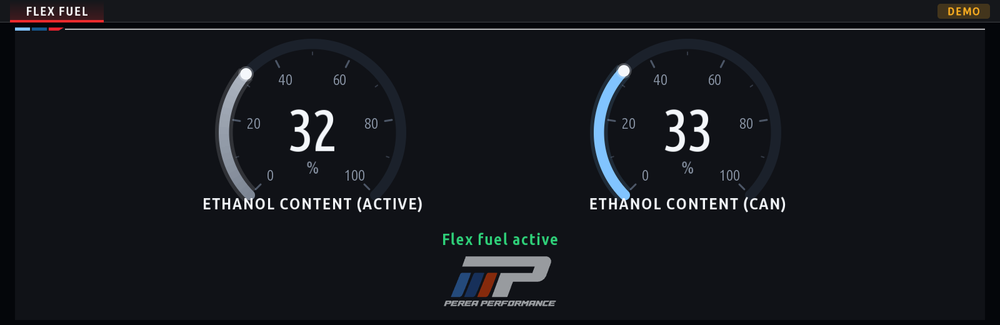

# Flex Fuel

The ethanol content an **MHD-flashed DME** runs on, read over the head unit's own diagnostic
link (InternalTasu, DME `0x12`) and shown as two dials: **Ethanol Content (Active)**, the value
the tune uses, and **Ethanol Content (CAN)**, what the flex fuel sensor reports through MHD's
CAN ethanol analyser. Under them a note says **Flex fuel active** (green) while the tune uses
the ethanol, and **Flex fuel disabled** when Active reads 0 (a map without flex fuel): in amber,
with the sensor's reading, when CAN still sees ethanol. When Active and CAN are 10 points or more
apart (the tune still blending after a fill-up, or a map that does not follow the sensor) the
header says **MISMATCH**. The app only reads; nothing is written to the car.



> **Experimental.** The addresses were captured on one car (G-series MG1, MHD 5.41, PRGID
> `00005D55503C05`). On any other ROM the app says *ROM not supported* and sends no read: see
> [Your ROM](#your-rom) to add it.

## What leaves the head unit

| Step | Request | Reply |
|---|---|---|
| Is MHD there? (ROM independent) | `2F 04 4D 48 44` ("MHD") | `6F 04 4D 48 44 32 ...` ("MHD2" + version); a stock DME refuses |
| Which ROM? | `22 F1 01`, `22 F1 02` | the SVK entries; MHD keys its addresses by the program (`08 00 00 ...`, "PRGID") and calibration (`0D 00 00 ...`, "CALID") ones |
| Define the identifier | `2C 03 F3 03` (clear), `2C 02 F3 03 14 B0 00 60 C2 01 B0 00 60 D2 01` | `6C 02 F3 03` |
| Read, twice a second | `22 F3 03` | `62 F3 03 <active> <can>`: one byte each, percent |

This is how MHD's own app logs those two channels (captured with PCAPdroid on the phone while
logging *Ethanol Content (Active)* and *(CAN)*, cross-checked against the exported CSV). Two
things to know:

- **`0x23` ReadMemoryByAddress is refused** on this DME (`7F 23 10`), although it worked on an
  S58 in another capture. The dynamic identifier (`2C` by memory address, format `14`: 1-byte
  size, 4-byte address) is what works everywhere MHD does.
- **The DME has four dynamic identifiers, `F300`..`F303`, and no more:** `2C 02 F304` is refused
  with `7F 2C 31` (request out of range), as the first test on the car showed. MHD's app defines
  `F300` (by identifier) and `F302` (by address) for a short channel list and clears all four when
  it connects, so this app takes `F303`, and `F301` when `F303` is refused (config `dynamicDids`).
  The DME forgets the definition at an ignition cycle (then `22 F3 03` answers `7F 22 31`): the
  app defines it again, at most 3 times in a row before it waits (5 s, 10 s, 20 s, 30 s) and
  starts over. The identifier is the DME's volatile table; nothing persists.

No diagnostic session change, no security access, no writes (`2E` / `3D`), no routines.

## Screen and states

Two `G.radial` dials (0-100 %) with the number in the middle, the note under them, and the
Perea Performance logo at the bottom. The header badge says what is going on when the dials
show `--`:

| Badge | Note | Meaning |
|---|---|---|
| `DEMO` | | made-up values (setting *Demo data*: Always, or Auto without a diagnostic transport, as in the emulator); nothing is sent |
| `NO LINK` | No diagnostic link / Diagnostic link down | the transport is not there yet (apps start before it at boot) or the car is asleep |
| `NO MHD` | MHD not found on the DME | the DME refused `2F 04` "MHD"; probed again every 30 s |
| `OTHER ROM` | ROM not supported, with the ids seen | MHD is there but no profile has this ROM's addresses; checked again every 60 s |
| `LINK STALE` | | three reads in a row without an answer; polling slows to 1 Hz, after ten it starts over |
| `MISMATCH` | Flex fuel active, *Active and CAN differ* | Active and CAN are 10 points or more apart (`GAP` in `ui.js`): the tune is still blending in the new fuel, or the map does not follow the sensor |
| | Flex fuel disabled (amber), *Sensor reads N %* | Active is 0 while the sensor reads ethanol: a map without flex fuel, or one that ignores the sensor |
| `DME ERROR` | Waiting for the DME | a refusal or a definition that will not hold; backoff, then start over |

Code: `protocol.js` (bytes in and out, pure), `poller.js` (the states, one request in flight),
`ui.js` (the screen), `main.js` (wiring, demo), `logo.js` (generated, see below).

## Your ROM

The two addresses are RAM locations in MHD's part of the DME software, so they move with the
ROM. `PROFILES` in `protocol.js` lists the ROMs they are known for:

```js
{ name: 'MHD on MG1 (PRGID 00005D55503C05)', prgid: '00005D55503C05', calid: '00008417503C1D',
  sgbd: '0F26B4', active: 'B00060C2', can: 'B00060D2' }
```

To add yours:

1. Find your PRGID and CALID: MHD prints them at the top of every exported log (`#Ecu PRGID`,
   `#Ecu CALID`), and the app logs the ids it saw (`mhd_flex: identifying -> unsupported-rom (ids ...)`).
2. Find the addresses: log only *Ethanol Content (Active)* and *(CAN)* in MHD while capturing
   the phone's traffic (PCAPdroid, target app MHD). The `2C 02 F3 0x 14 <addr> 01 ...` request in
   the capture lists the addresses in the order MHD logs them; the CSV tells which is which.
3. Add the profile and a test case in `kit/tools/test_mhd_flex.js`, and please open a PR.

A capture holds your VIN (`22 F1 90`): keep it to yourself. `captures/` is in `.gitignore`.

## Living with MHD's app

Both can be connected: every reply is filtered by its identifier, so MHD's `62 F3 00` answers
never count as ours. A session of MHD's app that clears the dynamic identifiers costs this app
one re-definition. The four identifiers are shared, though: while MHD's app logs a long channel
list it may define `F303` (or `F301`) itself, and then the two take the identifier from each
other in turn (this app sees a reply of the wrong length and defines again, up to 3 times, then
waits). Close this app's screen while logging with MHD, or log with MHD while this app's screen
is not shown: hidden, it sends nothing. While both poll, the head unit's transport is shared and
may answer busy now and then (`LINK STALE` for a moment).

## Logo

The kit has no image decoder and the build ships no image files, so the logo is a JavaScript
module of horizontal runs, drawn once into a cached GPU layer:

```sh
python3 kit/tools/make_logo.py docs/media/perea_logo.png --width 180 --out apps/mhd_flex/logo.js
```

The converter is generic: any transparent PNG / WebP, `--width`, `--opacity` (baked in: the logo
is meant to be subtle), `--ink` (pixels this dark take the theme's text colour, so a black logo
shows on the dark themes). It needs Pillow (`pip install pillow`).

## Build and test

```sh
node kit/tools/test_mhd_flex.js                 # protocol, poller states, filters, screen, main (no car, no SDK)
python3 kit/tools/build.py --preview-only mhd_flex
node kit/tools/preview.js dist/mhd_flex out/    # frames as PNG (demo data)
node kit/tools/emu.js mhd_flex                  # the app in the browser (demo data: nothing answers UDS there)
```

## Install from a USB stick (MGU Store, offline)

The [MGU Store](https://github.com/robertnisipeanu/mgu-store) installs apps from a USB stick
with no network ("Offline: USB stick" in its README). Its `mgu-install.js` writes the stick;
it needs Node 18 or newer on your computer (or use the standalone executable from the Store's
`installer` release, which needs no Node).

**A. Without BMW's SDK on your computer (the head unit builds the app).** The stick carries a
copy of this repository and the unit builds it from `mgu-repo.json`:

```sh
git clone https://github.com/robertnisipeanu/mgu-store.git
```

```sh
node mgu-store/deploy/mgu-install.js usb-repo /media/<your-stick> /path/to/pereaperformance-idrive7-apps
```

It copies the repository's tracked files to `<stick>/mgu-repo/<name>/`. Plug the stick into the
car, open the Store, go to its **USB** page and install **Flex Fuel**. The apps need the tools
`idrive7-renderd` (the GPU renderer) and `mgu-inputgate` from the same repository; the Store
installs them from the stick if the car does not have them yet.

**B. With the SDK (a ready package on the stick).** Extract `oap-sdk/` once from your own unit
(`node kit/tools/extract_sdk.js x_call/javascript/app.js`, section 3.1 of the main README), then:

```sh
python3 kit/tools/build.py mhd_flex
```

```sh
node mgu-store/deploy/mgu-install.js usb-repo /media/<your-stick> dist/mhd_flex@0.3.0.tgz
```

The package lands in `<stick>/mgu-repo/local/` with a generated catalog; install it from the
Store's **USB** page as above.

**A car without the Store yet:** `node mgu-store/deploy/mgu-install.js first-install --from
<stick>/mgu-repo/mgu-store --identity <root ssh key>` installs the Store itself from the stick
(the key is the unit's root SSH key, see the Store's README). Car parked, ignition on, ideally a
charger connected.

The `.mgu` files `build.py` makes contain BMW's SDK: keep them for your own car.
